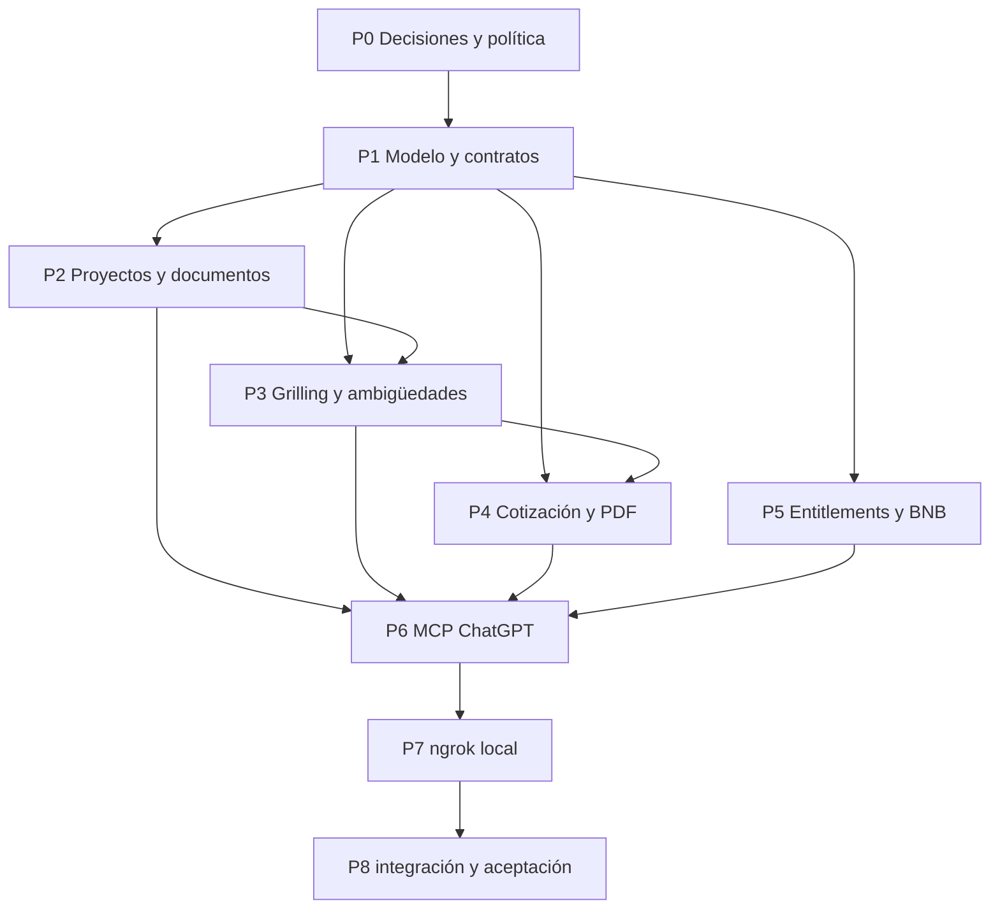

# Implementación de Presu

Plan de trabajo para implementar Presu sobre ScopeProfit y poder repartirlo entre agentes con tareas acotadas. Este documento define producto y dependencias; todavía no autoriza cambios en ScopeProfit, despliegues ni transacciones on-chain.

## Objetivo de v1

Desde ChatGPT, un cliente crea y guarda un proyecto, conversa para especificar una idea, adjunta documentos, resuelve ambigüedades y obtiene un alcance y una cotización PDF. BNB Chain debe estar contemplado en la primera versión. La evaluación describe preparación e implementabilidad según la información disponible; no asegura demanda, rentabilidad o validación de mercado.

“Presupuesto” en la interfaz es la propuesta/cotización producida a partir del alcance. No se solicita al cliente un monto máximo. Los créditos de uso son una regla de acceso al producto y deben mantenerse separados del importe comercial mostrado en la cotización.

## Restricción crítica: monetización en ChatGPT

Las reglas publicadas actualmente por OpenAI dicen que los plugins pueden vender bienes físicos, pero no productos o servicios digitales, suscripciones, contenido, tokens ni créditos, incluso como upsell freemium. Permiten explicar que una función requiere otro entitlement y enlazar una página informativa, pero prohíben iniciar el pago o enlazar checkout/transacciones. Esto entra en conflicto directo con cobrar desde la sexta cotización y vender suscripción luego de los diez usos de grilling.

**Gate P0:** antes de desarrollar cobros, decidir una experiencia compatible con las reglas vigentes o confirmar por escrito que una política/plataforma actualizada permite el modelo. Hasta resolverlo, el plugin podrá mostrar el estado y explicar que la función no está disponible; no implementar compra, wallet prompt, checkout, ni promoción de upgrade desde ChatGPT. Un cobro externo tampoco se debe iniciar ni enlazar desde el plugin sin confirmación de compatibilidad.

Fuente: [OpenAI Plugin Guidelines — Commerce and monetization](https://developers.openai.com/plugins/plugin-guidelines).

## Arquitectura y base existente

- Reutilizar ScopeProfit como base funcional, en una rama/worktree de trabajo separado. El repo Presu conserva este brief/plan hasta que se decida si será documentación o producto separado.
- ScopeProfit ya tiene proyectos, mensajes, archivos, Brief validado, preguntas, riesgos, estimaciones, cotizaciones por RateCard y renderizado PDF. Revisar el código actual antes de cambiar contratos.
- El backend debe ser la fuente de verdad para proyectos, documentos, alcance, permisos, entitlements y emisión de PDF. ChatGPT no conserva el estado comercial.
- La integración actual de ChatGPT se plantea como plugin MCP con herramientas backend; una UI embebida es opcional. No construir un segundo agente de conversación: el modelo de ChatGPT dirige el grilling y el backend persiste/valida el resultado.
- Para una cuenta personal se requiere identidad autenticada y asociación de usuario; no inferir identidad a partir del texto de chat. Usar OAuth 2.1 MCP o el mecanismo admitido por la plataforma seleccionada.
- Fuentes técnicas: [MCP server quickstart](https://developers.openai.com/plugins/build/app-quickstart), [MCP authentication](https://developers.openai.com/plugins/build/auth), [ChatGPT UI](https://developers.openai.com/plugins/build/chatgpt-ui).

## Decisiones de producto para cerrar en P0

| Decisión | Propuesta de trabajo | Estado |
|---|---|---|
| Categorías de cotización | Limitar el primer catálogo a productos de software/digitales que ScopeProfit pueda estimar con su modelo actual | Confirmar antes del catálogo |
| Créditos gratis | 5 cotizaciones exitosamente emitidas por cuenta | Definición de trabajo |
| Grilling gratuito | Hasta 10 inicios de proyecto con grilling por cuenta; seguir conversando o adjuntar docs dentro del mismo proyecto no consume otro uso | Semántica propuesta; confirmar |
| Cobro después del uso gratis | Requiere resolver el gate de política OpenAI; no fijar precio ni flujo aún | Bloqueado por P0 |
| BNB | Usar BNB Chain como red de pago en v1; moneda/token, red exacta y protocolo quedan por definir | Red confirmada; resto abierto |
| Moneda de cotización | Mostrar importe fiduciario según RateCard; no denominar en BNB por defecto | Propuesta |
| “Idea viable” | Decir “alcance suficientemente definido e implementable” solo si no hay ambigüedades bloqueantes; mostrar evidencia y límites | Definición de trabajo |
| Fuente de la tarifa | Reutilizar RateCard existente; definir qué RateCard y moneda aplican al usuario ChatGPT | Pendiente |
| Almacenamiento | Reusar persistencia y storage de ScopeProfit, con autorización por propietario | Propuesta técnica |

Una **ambigüedad bloqueante** es un dato ausente, contradictorio o vago que puede cambiar entregables, aceptación, estimación o cotización. El modelo debe registrar pregunta, evidencia/origen, impacto y condición bloqueante. Una respuesta del modelo no es evidencia de mercado por sí misma.

## Tareas del swarm

Las rutas bajo `scope-to-profit/` se refieren al repositorio base, no a este repo Presu. Asignar un agente por tarea. El agente coordinador integra y es el único que modifica Prisma/contratos compartidos; los demás deben trabajar contra los contratos acordados y no editarlos.

### P0 — Cerrar restricciones y decisiones de v1

**Responsable:** producto/arquitectura. **Dependencias:** ninguna. **Bloquea:** P1–P7.

- Resolver el gate de monetización de ChatGPT con la política oficial vigente. Si no hay ruta compatible, definir qué ofrece el plugin gratis y dónde existe una oferta de pago permitida sin iniciar ni enlazar una transacción desde ChatGPT.
- Confirmar qué planes/cuentas de ChatGPT pueden crear, conectar y usar el plugin MCP en el momento de implementación; no basar la disponibilidad de Presu en la respuesta antigua sobre GPT Actions.
- Confirmar categorías iniciales, RateCard/moneda, semántica de los dos contadores y política de reintentos/refundos.
- Definir token aceptado y protocolo de pago BNB Chain, red (testnet/mainnet), confirmaciones necesarias, expiración, reembolsos y manejo de pagos duplicados o tardíos.
- Elegir dónde vive el producto ejecutable: extensión de ScopeProfit o repo separado que consuma su API. Recomendación inicial: implementar en ScopeProfit y conservar Presu para brief/decisiones.
- Entregar decisiones en una tabla cerrada y actualizar este archivo antes de iniciar tareas que dependan de ellas.

**Aceptación:** todas las decisiones que cambian contratos, UX, seguridad o cobro tienen dueño y valor; el gate de política tiene evidencia enlazada; ningún agente implementa un flujo de cobro incompatible.

### P1 — Modelo persistente y contratos

**Responsable:** backend lead. **Dependencias:** P0. **Propiedad exclusiva:** `apps/api/prisma/schema.prisma`, migraciones y contratos compartidos.

- Extender el modelo existente solo para datos faltantes: propiedad del usuario ChatGPT, estado de grilling, ledger de usos/entitlements y referencias de pagos verificables si P0 los habilita.
- Definir operaciones atómicas/idempotentes para consumir un uso, crear cotización y acreditar pago. Fallos de LLM, PDF o pago no deben consumir ni duplicar créditos.
- Mantener enumeraciones de dominio como enums de Prisma y DTOs validados.
- Publicar contratos estables y ejemplos de request/response para que P2–P6 integren sin tocar schema ni contratos.

**Aceptación:** migración no destructiva, ownership explícito, consumo idempotente, pruebas de concurrencia/reintento para contadores y contrato aprobado por integradores.

### P2 — Proyectos, documentos y continuidad de sesión

**Responsable:** backend de proyectos. **Dependencias:** P1. **Archivos principales:** `apps/api/src/modules/projects/`, `chat/`, `files/`, `documents/`.

- Adaptar creación/listado/recuperación de proyectos para usuarios de ChatGPT, revisando la restricción actual de creación profesional.
- Permitir retomar conversación y adjuntar/consultar documentos en el proyecto correcto.
- Aplicar autorización de propietario en cada lectura/escritura; validar tipo y tamaño de archivo y mantener almacenamiento privado.
- Reusar los módulos existentes; no crear persistencia paralela en memoria del MCP.

**Aceptación:** dos usuarios no pueden consultar proyectos ni documentos ajenos; el propietario puede crear, listar, retomar y adjuntar archivo tras una nueva sesión de ChatGPT.

### P3 — Flujo de grilling y detección de ambigüedades

**Responsable:** agente/brief. **Dependencias:** P1 y P2. **Archivos principales:** `apps/api/src/modules/agent/`, `brief/`.

- Adaptar Brief y el agente actual para construir alcance desde conversación y documentos citables.
- Clasificar cada ambigüedad como bloqueante/no bloqueante con pregunta, fuente, impacto y criterio de resolución.
- Guiar al modelo para preguntar por las ambigüedades de mayor impacto, actualizar Brief al recibir respuesta y distinguir hechos, supuestos y opinión.
- No declarar validación de mercado ni emitir “viable” sin limitar el resultado a implementabilidad según datos disponibles.

**Aceptación:** el flujo detecta faltantes/contradicciones relevantes, muestra preguntas pendientes y evidencia; permite cerrar preguntas y mantener historial/versiones del alcance.

### P4 — Cotización y PDF único

**Responsable:** cotizaciones/documentos. **Dependencias:** P1 y P3. **Archivos principales:** `apps/api/src/modules/pricing/`, `documents/render-quote.ts`.

- Reusar `QuotesService`, RateCard y estimaciones deterministas de ScopeProfit.
- Bloquear cotización final cuando queden ambigüedades bloqueantes; permitir vista preliminar claramente marcada si producto decide soportarla.
- Generar un PDF cliente que reúna resumen, alcance, incluidos/excluidos, supuestos, riesgos, criterios de aceptación, estimación/precio, vigencia y próximos pasos.
- Resolver el límite actual de una cotización por proyecto sin perder versiones previas; cada PDF emitido debe ser reproducible e inmutable.
- Integrar el consumo del crédito solo en el punto confirmado por P0/P1 y hacer la operación idempotente.

**Aceptación:** PDF descargable legible, con scope y cifras provenientes de una versión concreta del Brief/RateCard; no hay emisión final con bloqueadores; doble invocación no duplica el cargo ni el documento.

### P5 — Entitlements y BNB Chain

**Responsable:** pagos. **Dependencias:** P0 y P1; cobro bloqueado por el gate de política.

- Implementar contadores separados: 5 cotizaciones gratis y 10 inicios de grilling gratis según semántica confirmada.
- Si el gate permite cobros compatibles, construir verificación de pagos BNB Chain en backend, asociando usuario, intención, importe/token/red, transacción y entitlement acreditado. Nunca confiar en un mensaje del modelo como prueba de pago.
- Evitar claves privadas en ChatGPT, prompts, logs o cliente; verificar emisor, destinatario, contrato/token, importe, red, estado y confirmaciones según la decisión P0.
- Empezar solo en testnet. No desplegar contratos ni transferir fondos reales como parte de esta tarea.
- Evaluar BNB Agent Studio/`bag` únicamente como herramienta de generación de seller agents; no asumir que implementa el ledger de créditos ni que es necesario para el MCP de Presu. Referencia: [BNB Agent Studio quickstart](https://docs.bnbchain.org/developer-kit/bnbchain-studio/quickstart/).

**Aceptación:** pruebas con pagos simulados/testnet cubren pago válido, red/token/importe incorrectos, duplicado, pago tardío y reversión/error; entitlement se acredita como máximo una vez. No habilitar compra en el plugin si la política no la permite.

### P6 — Plugin MCP de ChatGPT

**Responsable:** integración ChatGPT. **Dependencias:** P0 y contratos P1; integrar P2–P5.

- Exponer herramientas pequeñas y documentadas para crear/listar/abrir proyecto, añadir respuesta/documento, obtener preguntas y alcance, consultar estado de acceso y solicitar/descargar PDF.
- Aplicar OAuth/identidad con permisos mínimos; herramienta de mutación verifica propiedad de proyecto en backend.
- Añadir instrucciones/skill de uso que hagan que ChatGPT conduzca el grilling, cite documentos, pregunte antes de cerrar dudas y no invente estimaciones o pagos.
- Mantener UI embebida opcional para seleccionar proyecto, ver preguntas y abrir PDF; las herramientas deben funcionar sin UI.

**Aceptación:** desde un chat nuevo, el usuario autenticado puede empezar, guardar, retomar y terminar un proyecto; intentos sobre proyecto ajeno se rechazan; respuesta de herramienta distingue bloqueo, error y resultado.

### P7 — Entorno local con ngrok

**Responsable:** integración/dev experience. **Dependencias:** primera versión funcional de P6.

- Documentar comandos para iniciar API/MCP local y exponer el puerto real con `ngrok http <puerto>`.
- Configurar en el plugin la URL HTTPS entregada por ngrok con ruta `/mcp` (por ejemplo `https://<subdominio>.ngrok.app/mcp`); actualizarla cuando cambie el túnel.
- Probar primero con MCP Inspector en localhost y después conectar el MCP custom de ChatGPT en modo de desarrollo.
- No registrar contenido sensible de proyectos/documentos en logs del túnel. Un dominio temporal de ngrok sirve para desarrollo, no para publicación estable.

Referencia oficial y flujo: [OpenAI MCP quickstart — expose locally with ngrok](https://developers.openai.com/plugins/build/app-quickstart#expose-your-server-to-the-public-internet).

**Aceptación:** una sesión local completa atraviesa ChatGPT → ngrok HTTPS → `/mcp` → API local; caída o cambio de URL se diagnostica claramente; las instrucciones no exponen credenciales.

### P8 — Integración, seguridad y aceptación

**Responsable:** coordinador. **Dependencias:** P2–P7.

- Ejecutar scripts existentes de ScopeProfit para typecheck, lint, tests y build; añadir pruebas de integración para autorización, persistencia, gating, PDF y pagos simulados.
- Verificar expiración/revocación OAuth, aislamiento de proyectos, límites de archivo, idempotencia, prompt injection desde documentos y manejo de errores del proveedor de modelos.
- Aceptar el flujo completo: crear proyecto → adjuntar docs → grill y resolver bloqueos → guardar/retomar → emitir PDF → comprobar entitlement.
- Si se solicita E2E, usar el flujo TesterArmy `opencode-e2e` del repo/global; no sustituirlo por Playwright aislado.

**Aceptación:** checks del repo pasan; el flujo funcional deja evidencia observable en backend/PDF; no se habilitan transacciones reales ni publicación sin autorización separada.

## Orden y paralelismo

P2, P3, P4 y P5 pueden avanzar en paralelo después de acordar el contrato P1, siempre que cada responsable respete la propiedad de archivos. P5 puede diseñar/testear verificación sin habilitar compra mientras siga abierto el gate P0. P6 puede preparar metadatos MCP y herramientas mock mientras espera los servicios.

## Criterios de salida de v1

- El cliente puede iniciar y retomar proyectos desde ChatGPT; documentos y datos quedan asociados al usuario autenticado.
- El grilling produce alcance trazable a conversación/documentos y preguntas de ambigüedad con impacto.
- Presu no afirma validación de mercado por falta de evidencia y no presenta como lista una propuesta con bloqueos.
- El PDF integra alcance y cotización calculada desde datos guardados y permite identificar la versión usada.
- Los usos gratuitos se cuentan con reglas separadas e idempotentes.
- La integración contempla BNB Chain; la compra efectiva solo se habilita si resuelve el gate de políticas y P0 cerró red/token/protocolo.
- El flujo de desarrollo local mediante ngrok HTTPS y `/mcp` está documentado y probado.

## No incluido todavía

Precio del producto, contratación de suscripción, checkout, red/token de BNB, despliegue de contrato, transacciones mainnet, publicación pública del plugin, investigación de mercado automatizada y categorías de presupuesto fuera de software. Cada punto requiere las decisiones indicadas en P0.
