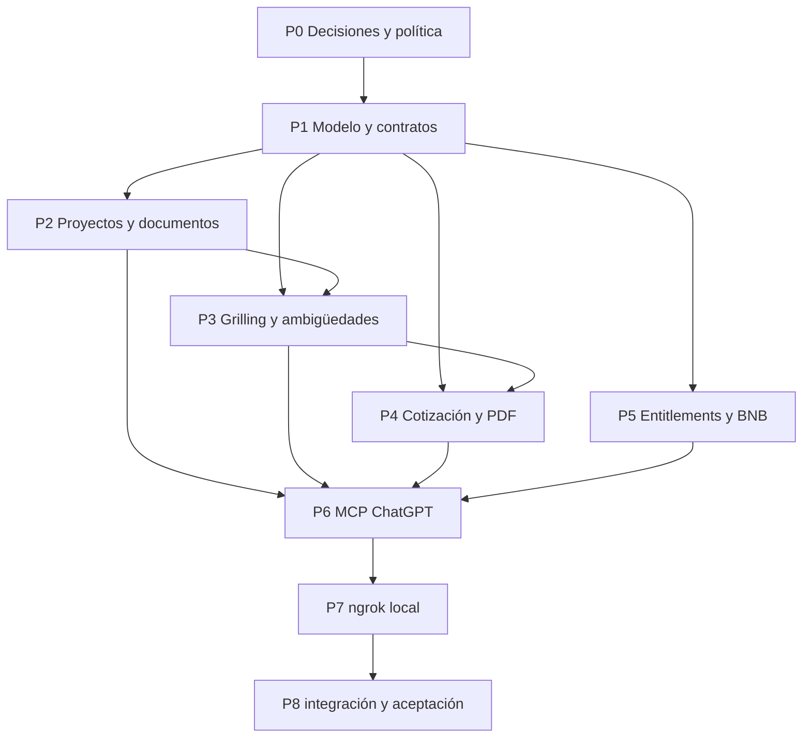

# Implementación de Presu

Plan de trabajo para implementar Presu como producto y backend independientes. ScopeProfit sirve como referencia funcional para proyectos, documentos, alcance y cotizaciones; Presu no comparte su runtime, cuentas, persistencia ni contratos. Este brief cierra el alcance de créditos y pagos BNB. Autoriza cambios locales en la rama de implementación; no autoriza mainnet, fondos reales ni publicación.

## Objetivo de v1

Desde ChatGPT, un cliente crea y guarda un proyecto, conversa para especificar una idea, adjunta documentos, resuelve ambigüedades y obtiene un alcance y una cotización PDF. BNB Chain debe estar contemplado en la primera versión. La evaluación describe preparación e implementabilidad según la información disponible; no asegura demanda, rentabilidad o validación de mercado.

“Presupuesto” en la interfaz es la propuesta/cotización producida a partir del alcance. No se solicita al cliente un monto máximo. Los créditos de uso son una regla de acceso al producto y deben mantenerse separados del importe comercial mostrado en la cotización.

## Restricción crítica: monetización en ChatGPT

Las reglas publicadas actualmente por OpenAI dicen que los plugins pueden vender bienes físicos, pero no productos o servicios digitales, suscripciones, contenido, tokens ni créditos, incluso como upsell freemium. Permiten explicar que una función requiere otro entitlement y enlazar una página informativa, pero prohíben iniciar el pago o enlazar checkout/transacciones. Esto entra en conflicto directo con cobrar desde la sexta cotización y vender suscripción luego de los diez usos de grilling.

**Gate P0:** las reglas vigentes no permiten vender créditos digitales dentro del plugin, incluso como upsell freemium, ni iniciar o enlazar su compra desde ChatGPT. Los pagos BNB se implementan únicamente en la web de Presu. Hasta que OpenAI apruebe explícitamente el uso de créditos pagados en el plugin, ChatGPT no los consulta, consume ni promociona; tampoco ofrece checkout ni wallet prompts.

Fuente: [OpenAI Plugin Guidelines — Commerce and monetization](https://developers.openai.com/plugins/plugin-guidelines).

## Arquitectura y referencia

- Presu es un producto separado. Este repositorio aloja su código y sus contratos; no extender ni desplegar el backend de ScopeProfit para servir usuarios de Presu.
- ScopeProfit es referencia de producto y de implementación para proyectos, mensajes, archivos, Brief validado, preguntas, riesgos, estimaciones, RateCard y renderizado PDF. Reimplementar dentro de Presu solo lo que su alcance requiera, con dominio, identidad, persistencia y APIs propios.
- El backend debe ser la fuente de verdad para proyectos, documentos, alcance, permisos, entitlements y emisión de PDF. ChatGPT no conserva el estado comercial.
- La integración actual de ChatGPT se plantea como plugin MCP con herramientas backend; una UI embebida es opcional. No construir un segundo agente de conversación: el modelo de ChatGPT dirige el grilling y el backend persiste/valida el resultado.
- Para una cuenta personal se requiere identidad autenticada y asociación de usuario; no inferir identidad a partir del texto de chat. Usar OAuth 2.1 MCP o el mecanismo admitido por la plataforma seleccionada.
- Fuentes técnicas: [MCP server quickstart](https://developers.openai.com/plugins/build/app-quickstart), [MCP authentication](https://developers.openai.com/plugins/build/auth), [ChatGPT UI](https://developers.openai.com/plugins/build/chatgpt-ui).

## Decisiones de producto para cerrar en P0

| Decisión | Propuesta de trabajo | Estado |
|---|---|---|
| Categorías de cotización | Limitar el primer catálogo a productos de software/digitales que ScopeProfit pueda estimar con su modelo actual | Confirmar antes del catálogo |
| Créditos gratis | 5 cotizaciones finales emitidas por cuenta de Presu | Confirmado |
| Grilling gratuito | Ilimitado: crear proyecto, conversar y adjuntar docs no consume créditos ni inicios | Confirmado (decisión de producto) |
| Cobro después del uso gratis | Web de Presu; un pago exitoso acredita un crédito de cotización. El precio en wei se configura en backend y no se fija en este brief | Confirmado para testnet |
| BNB | BNB nativo en BSC Testnet (chain ID 97), transferencia directa a una dirección receptora configurada. Sin contrato propio | Confirmado para testnet |
| Compra desde ChatGPT | No iniciar ni enlazar compras. Consumir créditos pagados desde el plugin queda deshabilitado hasta aprobación explícita de OpenAI | Confirmado como gate |
| Moneda de cotización | Mostrar importe fiduciario según RateCard; no denominar en BNB por defecto | Propuesta |
| “Idea viable” | Decir “alcance suficientemente definido e implementable” solo si no hay ambigüedades bloqueantes; mostrar evidencia y límites | Definición de trabajo |
| Fuente de la tarifa | Reutilizar RateCard existente; definir qué RateCard y moneda aplican al usuario ChatGPT | Pendiente |
| Almacenamiento | Persistencia y storage propios de Presu, con autorización por propietario | Confirmado |

Una **ambigüedad bloqueante** es un dato ausente, contradictorio o vago que puede cambiar entregables, aceptación, estimación o cotización. El modelo debe registrar pregunta, evidencia/origen, impacto y condición bloqueante. Una respuesta del modelo no es evidencia de mercado por sí misma.

## Decisiones cerradas para créditos y BNB

- Los créditos pertenecen a una cuenta autenticada de Presu y no se aplican a las cuentas ni a las cotizaciones profesionales existentes de ScopeProfit.
- Una cuenta recibe cinco créditos gratuitos una sola vez. Cada cotización final consume uno únicamente cuando sus datos y PDF quedan emitidos/persistidos; los borradores, errores y reintentos idempotentes no consumen otro crédito.
- Los diez inicios gratuitos de *grilling* siguen siendo un contador separado. Una cotización no consume un uso de *grilling* y viceversa.
- La compra de créditos se hace en la web de Presu, fuera del plugin. El backend acredita el saldo para uso en la web; no exponer ni consumir créditos pagados desde ChatGPT hasta obtener aprobación explícita de OpenAI.
- El MVP de pagos usa transferencias de BNB nativo en BSC Testnet, chain ID 97. La documentación BNB identifica tBNB como el activo de testnet. [Redes y configuración oficiales de BNB](https://docs.bnbchain.org/bnb-smart-chain/developers/wallet-configuration/).
- La cantidad a pagar se expresa en wei y se configura solo en backend; no se muestra ni se acepta un precio enviado por el modelo o el navegador. Si falta el precio o la dirección receptora, no se crean intenciones de pago.
- El verificador valida en backend la red, el hash único, el remitente vinculado a la cuenta, el destinatario configurado, el importe exacto, el estado exitoso del recibo y las confirmaciones requeridas. Una wallet se vincula a la cuenta mediante una prueba firmada; conocer un hash de transacción no basta para reclamar créditos.
- Las claves privadas nunca se guardan ni se usan en Presu. El backend solo observa la cadena y acredita cada transacción como máximo una vez.
- Mainnet, fondos reales, precio comercial final y política de reembolsos requieren una decisión y autorización posteriores.

## Tareas del swarm

Las rutas `apps/api/` y `apps/web/` se refieren al producto Presu en este repositorio. El agente coordinador integra y es el único que modifica el esquema y contratos compartidos; los demás trabajan contra contratos acordados.

### P0 — Cerrar restricciones y decisiones restantes de v1

**Responsable:** producto/arquitectura. **Dependencias:** ninguna. Bloquea las tareas que dependan de decisiones aún pendientes; el ledger de cotizaciones y el verificador de BSC Testnet pueden comenzar con los acuerdos cerrados en este brief.

- Mantener el gate de monetización de ChatGPT: no vender, promocionar, consumir ni iniciar/enlazar compras de créditos desde el plugin. Los pagos del MVP se completan en la web de Presu; solicitar aprobación antes de cambiar este límite.
- Confirmar qué planes/cuentas de ChatGPT pueden crear, conectar y usar el plugin MCP en el momento de implementación; no basar la disponibilidad de Presu en la respuesta antigua sobre GPT Actions.
- Confirmar categorías iniciales, RateCard/moneda, semántica del contador de *grilling* y política de reembolsos.
- Configurar el importe en wei por crédito, dirección receptora, RPC y mínimo de confirmaciones en el entorno de testnet; si falta algún valor requerido, deshabilitar la compra. No configurar ni habilitar mainnet.
- La ubicación está definida: implementar el producto en el repositorio Presu. No consumir APIs de ScopeProfit en runtime ni modificar su repositorio para completar Presu.
- Entregar decisiones en una tabla cerrada y actualizar este archivo antes de iniciar tareas que dependan de ellas.

**Aceptación:** las decisiones necesarias para el MVP de créditos/BNB están en la sección anterior; las decisiones restantes tienen dueño y valor antes de implementar las funciones que dependen de ellas; ningún agente implementa checkout en ChatGPT.

### P1 — Modelo persistente y contratos

**Responsable:** backend lead. **Dependencias:** identidad autenticada y decisiones de créditos/BNB de este brief. **Propiedad exclusiva:** `apps/api/prisma/schema.prisma`, migraciones y contratos compartidos.

- Crear el modelo de cuenta autenticada de Presu, ledger de créditos y referencias verificables de pagos BNB.
- Definir operaciones atómicas/idempotentes para consumir un uso, crear cotización y acreditar pago. Fallos de LLM, PDF o pago no deben consumir ni duplicar créditos.
- Mantener enumeraciones de dominio como enums de Prisma y DTOs validados.
- Publicar contratos estables y ejemplos de request/response para que P2–P6 integren sin tocar schema ni contratos.

**Aceptación:** migración no destructiva, ownership explícito, consumo idempotente, pruebas de concurrencia/reintento para contadores y contrato aprobado por integradores.

### P2 — Proyectos, documentos y continuidad de sesión

**Responsable:** backend de proyectos. **Dependencias:** P1. **Archivos principales:** `apps/api/src/modules/projects/`, `chat/`, `files/`, `documents/`.

- Adaptar creación/listado/recuperación de proyectos para usuarios de ChatGPT, revisando la restricción actual de creación profesional.
- Permitir retomar conversación y adjuntar/consultar documentos en el proyecto correcto.
- Aplicar autorización de propietario en cada lectura/escritura; validar tipo y tamaño de archivo y mantener almacenamiento privado.
- Implementar los módulos de proyecto, chat, documentos y storage dentro de Presu; el MCP no tendrá persistencia paralela en memoria.

**Aceptación:** dos usuarios no pueden consultar proyectos ni documentos ajenos; el propietario puede crear, listar, retomar y adjuntar archivo tras una nueva sesión de ChatGPT.

### P3 — Flujo de grilling y detección de ambigüedades

**Responsable:** agente/brief. **Dependencias:** P1 y P2. **Archivos principales:** `apps/api/src/modules/agent/`, `brief/`.

- Adaptar Brief y el agente actual para construir alcance desde conversación y documentos citables.
- Clasificar cada ambigüedad como bloqueante/no bloqueante con pregunta, fuente, impacto y criterio de resolución.
- Guiar al modelo para preguntar por las ambigüedades de mayor impacto, actualizar Brief al recibir respuesta y distinguir hechos, supuestos y opinión.
- No declarar validación de mercado ni emitir “viable” sin limitar el resultado a implementabilidad según datos disponibles.

**Aceptación:** el flujo detecta faltantes/contradicciones relevantes, muestra preguntas pendientes y evidencia; permite cerrar preguntas y mantener historial/versiones del alcance.

### P4 — Cotización y PDF único

**Responsable:** cotizaciones/documentos. **Dependencias:** P1 y P3. **Archivos principales:** `apps/api/src/modules/pricing/`, `documents/render-quote.ts`.

- Implementar en Presu su cotizador, RateCard y estimaciones deterministas tomando como referencia el comportamiento de ScopeProfit.
- Bloquear cotización final cuando queden ambigüedades bloqueantes; permitir vista preliminar claramente marcada si producto decide soportarla.
- Generar un PDF cliente que reúna resumen, alcance, incluidos/excluidos, supuestos, riesgos, criterios de aceptación, estimación/precio, vigencia y próximos pasos.
- Resolver el límite actual de una cotización por proyecto sin perder versiones previas; cada PDF emitido debe ser reproducible e inmutable.
- Integrar el consumo del crédito solo en el punto confirmado por P0/P1 y hacer la operación idempotente.

**Aceptación:** PDF descargable legible, con scope y cifras provenientes de una versión concreta del Brief/RateCard; no hay emisión final con bloqueadores; doble invocación no duplica el cargo ni el documento.

### P5 — Créditos y pagos BNB Chain

**Responsable:** pagos. **Dependencias:** modelo/contratos P1 y configuración de BSC Testnet; la compra se sirve desde la web de Presu.

- Acreditar cinco créditos de cotización gratis una sola vez por cuenta de Presu y descontar uno solo al emitir la cotización final con PDF persistido; conservar separado el contador de *grilling*.
- La web de Presu crea una intención de pago con un crédito y el importe calculado por el backend; la wallet del usuario firma una transferencia de tBNB al destinatario configurado. El importe y la dirección nunca se aceptan del navegador como autoridad.
- Vincular la wallet a la cuenta con un desafío de un solo uso firmado; asociar la transacción a esa cuenta y acreditar el ledger en una operación idempotente.
- Verificar chain ID 97, hash no usado, remitente, destinatario, importe en wei, `receipt.status` exitoso y número de confirmaciones. No depender de afirmaciones del modelo ni de la respuesta del cliente.
- Si la transferencia es válida pero aún no alcanza las confirmaciones requeridas, mantenerla pendiente. Importe incorrecto o transacción fallida no acredita créditos y queda registrada para revisión; no inferir reembolso automático.
- No exponer saldo comprado ni habilitar su consumo, compra, wallet prompt, pago o enlace transaccional en herramientas/UI de ChatGPT. No guardar claves privadas ni desplegar contrato.
- Evaluar BNB Agent Studio/`bag` únicamente como herramienta de generación de seller agents; no asumir que implementa el ledger de créditos ni que es necesario para el MCP de Presu. Referencia: [BNB Agent Studio quickstart](https://docs.bnbchain.org/developer-kit/bnbchain-studio/quickstart/).

**Aceptación:** pruebas cubren la concesión inicial única, consumo y reintentos, pago válido, red/remitente/destinatario/importe incorrectos y hash duplicado; transferencias sin éxito quedan registradas y las que esperan confirmaciones siguen pendientes. Ninguna compra se inicia desde ChatGPT.

### P6 — Plugin MCP de ChatGPT

**Responsable:** integración ChatGPT. **Dependencias:** P0 y contratos P1; integrar P2–P5.

- Exponer herramientas pequeñas y documentadas para crear/listar/abrir proyecto, añadir respuesta/documento, obtener preguntas y alcance, consultar estado de acceso y solicitar/descargar PDF.
- Aplicar OAuth/identidad con permisos mínimos; herramienta de mutación verifica propiedad de proyecto en backend.
- Añadir instrucciones/skill de uso que hagan que ChatGPT conduzca el grilling, cite documentos, pregunte antes de cerrar dudas y no invente estimaciones o pagos.
- Las herramientas no exponen compra, checkout, wallet prompts ni enlaces transaccionales. No consumen créditos pagados hasta la aprobación indicada en P0.
- Mantener UI embebida opcional para seleccionar proyecto, ver preguntas y abrir PDF; las herramientas deben funcionar sin UI.

**Aceptación:** desde un chat nuevo, el usuario autenticado puede empezar, guardar, retomar y terminar un proyecto; intentos sobre proyecto ajeno se rechazan; respuesta de herramienta distingue bloqueo, error y resultado.

### P7 — Entorno local con ngrok

**Responsable:** integración/dev experience. **Dependencias:** primera versión funcional de P6.

- Documentar comandos para iniciar API/MCP local y exponer el puerto real con `ngrok http <puerto>`.
- Configurar en el plugin la URL HTTPS entregada por ngrok con ruta `/mcp` (por ejemplo `https://<subdominio>.ngrok.app/mcp`); actualizarla cuando cambie el túnel.
- Probar primero con MCP Inspector en localhost y después conectar el MCP custom de ChatGPT en modo de desarrollo.
- No registrar contenido sensible de proyectos/documentos en logs del túnel. Un dominio temporal de ngrok sirve para desarrollo, no para publicación estable.

Referencia oficial y flujo: [OpenAI MCP quickstart — expose locally with ngrok](https://developers.openai.com/plugins/build/app-quickstart#expose-your-server-to-the-public-internet).

**Aceptación:** una sesión local completa atraviesa ChatGPT → ngrok HTTPS → `/mcp` → API local; caída o cambio de URL se diagnostica claramente; las instrucciones no exponen credenciales.

### P8 — Integración, seguridad y aceptación

**Responsable:** coordinador. **Dependencias:** P2–P7.

- Ejecutar los scripts propios de Presu para typecheck, lint, tests y build; añadir pruebas de integración para autorización, persistencia, gating, PDF y pagos simulados.
- Verificar expiración/revocación OAuth, aislamiento de proyectos, límites de archivo, idempotencia, prompt injection desde documentos y manejo de errores del proveedor de modelos.
- Aceptar el flujo completo: crear proyecto → adjuntar docs → grill y resolver bloqueos → guardar/retomar → emitir PDF → comprobar entitlement.
- Si se solicita E2E, usar el flujo TesterArmy `opencode-e2e` del repo/global; no sustituirlo por Playwright aislado.

**Aceptación:** checks del repo pasan; el flujo funcional deja evidencia observable en backend/PDF; no se habilitan transacciones reales ni publicación sin autorización separada.

## Orden y paralelismo

P2, P3, P4 y P5 pueden avanzar en paralelo después de acordar el contrato P1, siempre que cada responsable respete la propiedad de archivos. P5 puede implementar la compra web y verificación en BSC Testnet; ChatGPT sigue sin usar créditos pagados hasta que la política lo permita. P6 puede preparar metadatos MCP y herramientas mock mientras espera los servicios.

## Criterios de salida de v1

- El cliente puede iniciar y retomar proyectos desde ChatGPT; documentos y datos quedan asociados al usuario autenticado.
- El grilling produce alcance trazable a conversación/documentos y preguntas de ambigüedad con impacto.
- Presu no afirma validación de mercado por falta de evidencia y no presenta como lista una propuesta con bloqueos.
- El PDF integra alcance y cotización calculada desde datos guardados y permite identificar la versión usada.
- Los usos gratuitos se cuentan con reglas separadas e idempotentes.
- ChatGPT consume solo créditos gratuitos hasta que la política permita otra cosa; las compras BNB del MVP ocurren en la web de Presu y solo en BSC Testnet.
- El flujo de desarrollo local mediante ngrok HTTPS y `/mcp` está documentado y probado.

## No incluido todavía

Precio comercial definitivo, reembolsos, mainnet/fondos reales, compra de créditos desde ChatGPT, suscripciones, despliegue de contrato, publicación pública del plugin, investigación de mercado automatizada y categorías de presupuesto fuera de software. Cada punto requiere una decisión posterior.
